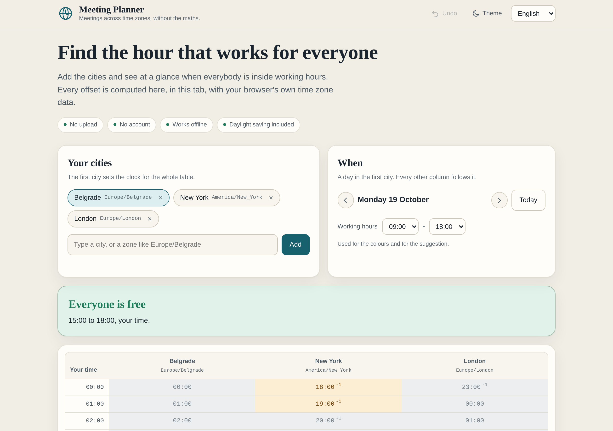

# Meeting Planner

**Find the hour that works for everyone.**

[](https://tekideki.github.io/Meeting-Planner/)
[](LICENSE)



Meeting Planner puts the cities of a call side by side and shows which hours of the day are inside working hours for all of them. It runs entirely in the browser: no server, no account, no analytics, and nothing is uploaded.

---

## What it does

- **A grid, not a calculator.** Columns are cities, rows are hours in the first city. Every cell shows the real local time there, coloured by whether it is working time, awake time or the middle of the night.
- **It answers the actual question.** Above the table, in one sentence: when everyone is free, or how close you got when nobody is. "Closest is 2 of 3 cities inside working hours" is a useful answer, not a failure.
- **Half hour and quarter hour zones are exact.** Kolkata, Kathmandu, Adelaide and Chatham are not rounded into a false overlap.
- **Daylight saving is real.** Offsets come from the browser's `Intl` data, so a country changing its rules needs no update here.
- **Read any hour in every city.** Pick a row and the page lists the local time for each city, with a copy button that gives you a message ready to paste into a chat.
- **A shareable link.** The cities and the day live in the address bar, so sending the link shows the other side exactly what you see. No server involved.
- **Four languages.** English, Romanian, Serbian Latin and Serbian Cyrillic. The chosen language is remembered.

## How to use it

1. Open the page. Your own city is loaded first, and it sets the clock for the table.
2. Add the other cities. Type a name (`tokyo`), or any IANA zone (`Asia/Tokyo`) when the city is not in the list.
3. Set the working hours if 9 to 18 does not match the people on the call.
4. Green is working, amber is awake, grey is the night. The sentence above the table tells you the best window.
5. Pick a row to read that hour in each city, then **Copy** and paste it into the chat.
6. Send the address of the page if the other side wants to check it themselves.

## Why the offsets are not in the page

A printed offset table has two problems: it is wrong the moment a government changes a daylight saving rule, and it is wrong for half the world for part of every year, because the northern and southern hemispheres switch on different dates.

So the page ships no table at all. It asks the browser, which already carries the time zone database:

```js
new Intl.DateTimeFormat('en-GB', { timeZone: zone, hourCycle: 'h23', ... })
```

Two details that matter in practice:

- **`hourCycle: 'h23'` is explicit.** With `hour12: false` some engines report midnight as `24`, and every offset calculated from it is wrong by a day.
- **Midnight is searched, not calculated.** Several zones have skipped 00:00 on a daylight saving switch, so "the start of the day" is found with a binary search rather than with arithmetic.

## What it does not do

- **No calendar access.** It does not read your calendar, and it does not know when anyone is busy. It finds the hour that is *civilised*, and you bring the availability.
- **No accounts and no invite links.** A link carries the cities and the day, not a meeting.
- **No holiday calendar.** Friday in one country can be a weekend in another; this tool only knows hours, not calendars.
- **No claim that a green hour is convenient for a person.** Someone can be asleep at 11:00. The colours describe clock time, not human beings.

## Privacy

- No request leaves the page while you use it. The UI test records every request and asserts none is made after load.
- The city list, the chosen day, the working hours, the language and the theme are kept in `localStorage`, under `td-zones.*`.
- No cookies, no analytics, no third party script, no web font, no CDN.
- After the first visit a service worker keeps the shell, so the page opens with no connection and still computes correctly: the time zone data was already there.

## Files

| Path | What it is |
|---|---|
| `src/planner.js` | The time zone engine. Pure functions, no DOM, also loadable in Node. |
| `src/cities.js` | 117 well known cities with their IANA zone. |
| `src/app.js` | Interface: rendering, state, the address bar, the undo stack. |
| `src/i18n/locales.json` | English, Romanian and Serbian Latin. Cyrillic is generated. |
| `src/template.html` | The page shell, with `data-i18n` keys instead of hardcoded text. |
| `src/styles.css` | All styling. Light and dark, no external font. |
| `build.py` | Inlines everything into one `index.html`. Deterministic. |
| `index.html` | The built page. Committed, so GitHub Pages serves it directly. |
| `tests/logic_test.cjs` | Engine and city list tests, no browser. |
| `tests/ui_test.py` | Playwright on desktop and touch tablet. |
| `tools/make_icons.py` | Draws every icon, so no binary source is committed. |
| `tools/make_screenshots.py` | Captures the screenshots and the social card. |
| `sw.js` | Offline shell. Bump `VERSION` when `index.html` changes. |

## Development

```bash
python3 build.py                 # writes index.html
node tests/logic_test.cjs        # 79 checks, no browser
python3 tests/ui_test.py         # 58 checks, desktop and tablet
python3 tools/make_icons.py      # only when the icon changes
python3 tools/make_screenshots.py
```

`build.py` refuses to produce a file that contains an em dash, an en dash, a byte order mark, a replacement character, a literal `</script>` inside inlined JavaScript, a locale with a missing or extra key, or a placeholder that differs between locales. The same sources always give a byte identical `index.html`.

## Limits

- The city list is a convenience, not a gazetteer. Any IANA zone works when typed in full.
- City names are shown in their common English form in every language. They are proper nouns.
- Eight cities is the maximum, because past that the table stops being readable on a phone.
- The table covers one day at a time, in the first city's calendar.

## License

Apache-2.0. See [LICENSE](LICENSE) and [NOTICE](NOTICE).

## Support

The tools are free and stay free: no courses, no coaching, no "make money with AI". If you want to support the work: [paypal.me/TekiDeki](https://paypal.me/TekiDeki).
